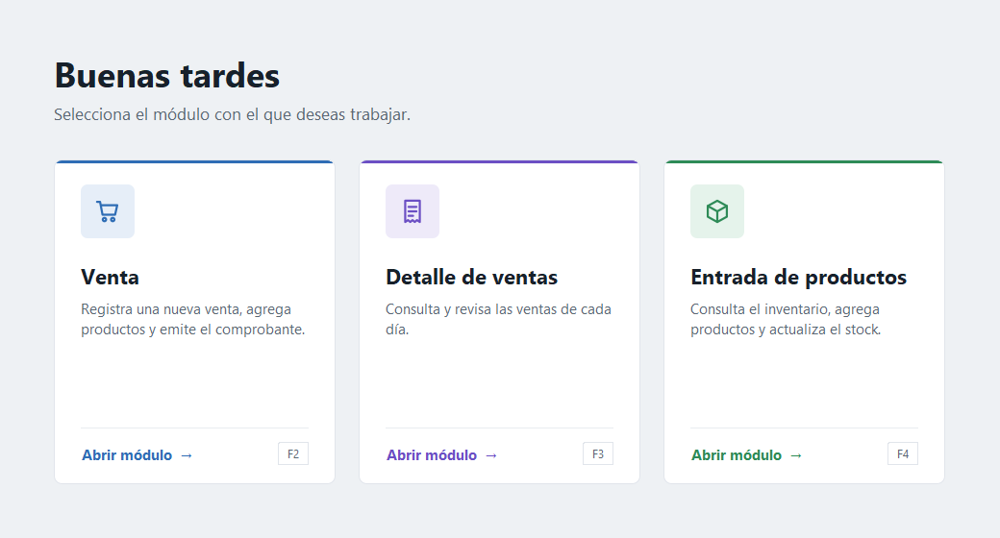
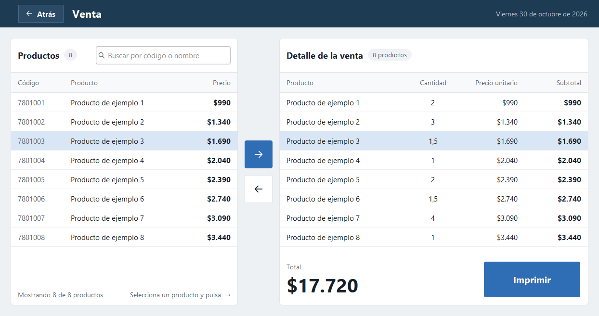
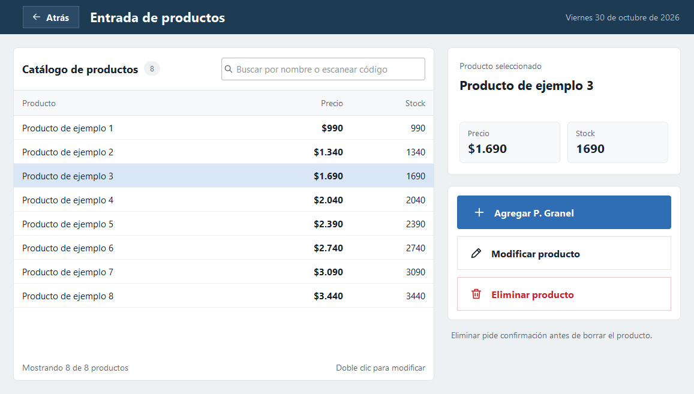
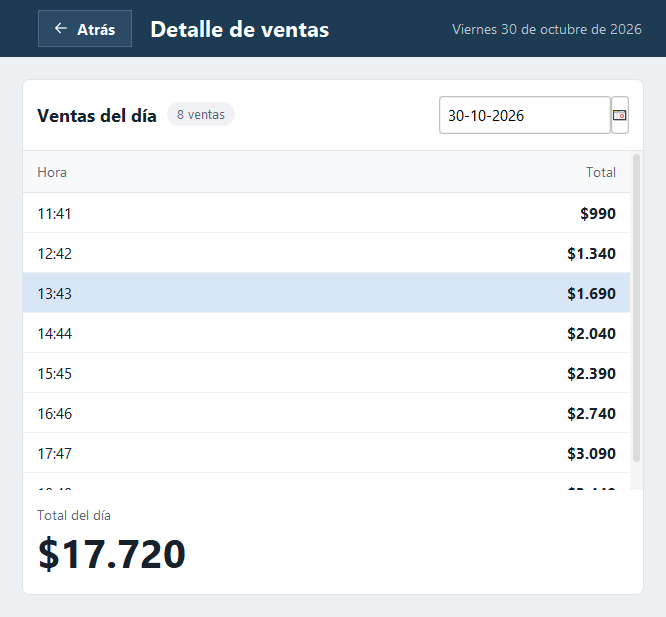
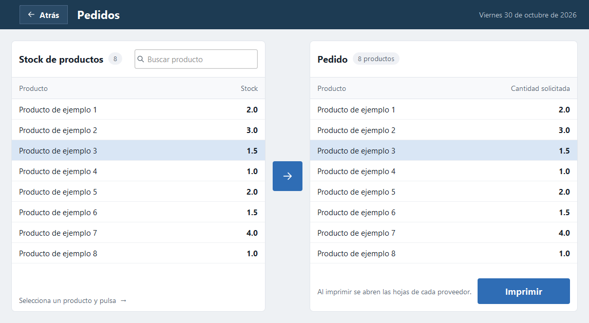
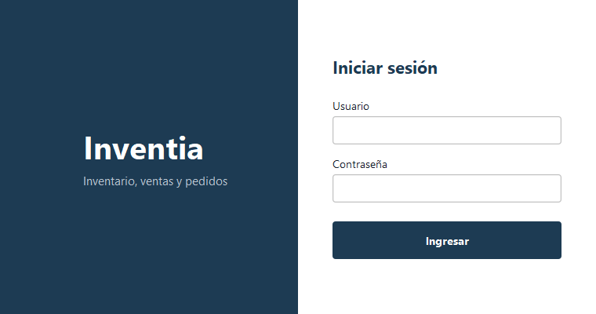
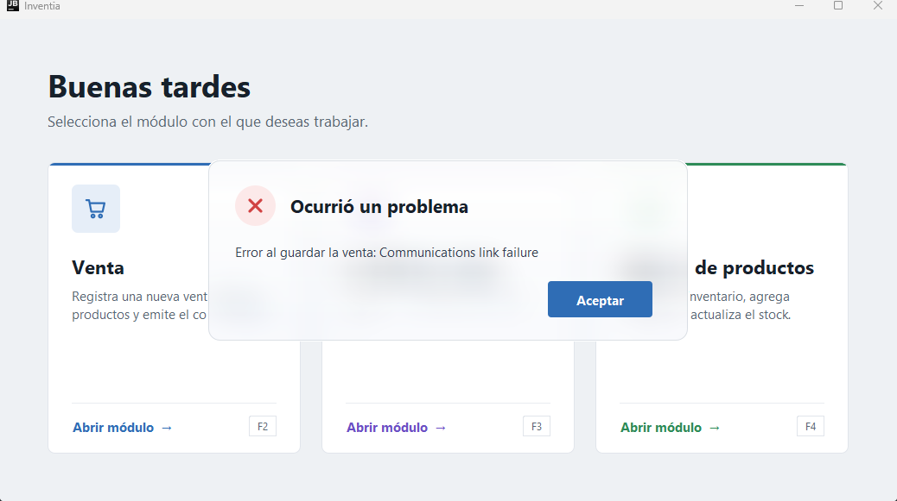

<div align="center">

# Inventia

**Inventario, ventas y pedidos para un negocio, en una aplicación de escritorio.**




</div>

## Descripción

Inventia reúne en una sola aplicación lo que un negocio necesita en el día a día: registrar ventas
(con lector de códigos de barras), revisar lo vendido cada día, mantener el catálogo de productos y
preparar los pedidos de reposición a los proveedores. Funciona sobre MySQL y se distribuye como un
único archivo `.jar`.

## Características

- **Ventas con escáner.** Se busca o se escanea un producto y se agrega a la venta. Los productos a
  granel piden la cantidad en kilos. El total se calcula al instante y la venta se registra con el
  botón Imprimir.
- **Detalle diario.** Las ventas de cualquier fecha, con su hora y el total del día.
- **Catálogo de productos.** Búsqueda por nombre o por código escaneado, y alta, modificación y
  eliminación de productos, incluidos los de venta a granel.
- **Pedidos a proveedores.** Se arma el pedido desde el stock y se abre la hoja de cada proveedor.
- **Interfaz cuidada.** Tema claro y sobrio, tablas legibles, atajos de teclado y avisos con efecto
  de vidrio esmerilado que suben desde la parte baja de la pantalla.

## Capturas

Las imágenes usan datos de ejemplo.

| Venta | Entrada de productos |
| :---: | :---: |
|  |  |

| Detalle de ventas | Pedidos |
| :---: | :---: |
|  |  |

| Inicio de sesión | Aviso |
| :---: | :---: |
|  |  |

## Tecnologías

- **Java 21** y **Swing**
- **FlatLaf** para el tema visual
- **JCalendar** para el selector de fechas
- **MySQL** con **MySQL Connector/J** para los datos
- **Maven** para la compilación (con el plugin Shade para el `.jar` único)

## Requisitos

- Java 21 o superior
- MySQL, con la base de datos de la aplicación en `localhost:3306`
- Windows (el diseño usa la fuente Segoe UI)

## Uso

La aplicación se entrega como un único archivo que incluye todas sus dependencias. Con doble clic,
o desde una consola:

```powershell
java -jar Inventia_1.2.0.jar
```

**Atajos del menú principal:** `F2` abre Venta, `F3` Detalle de ventas y `F4` Entrada de productos.
`Esc` cierra un aviso y `Enter` lo acepta.

Para actualizar a una versión nueva, conserva una copia del `.jar` anterior y copia el nuevo al lado.
No abras dos versiones a la vez, porque las dos usan la misma base de datos.

## Compilar

**Sin Maven**, con el script incluido:

```powershell
.\empaquetar.ps1
```

Genera `dist\Inventia.jar`. Renómbralo con la versión que corresponda. La primera vez descarga FlatLaf
y el driver de MySQL.

**Con Maven o NetBeans:** *Clean and Build*, o

```powershell
mvn clean package
```

El resultado queda en `Inventia-main\target\Inventia-1.0-SNAPSHOT.jar`.

## Desarrollo

Para trabajar en la interfaz no hace falta tener la base de datos:

```powershell
.\ejecutar.ps1                 # compila y abre el menú principal
.\ejecutar.ps1 Ventas          # abre una vista concreta
.\ejecutar.ps1 -Captura        # guarda una imagen de cada vista, con datos de ejemplo
.\ejecutar.ps1 -Avisos         # muestra cada tipo de aviso y guarda una imagen
```

Sin base de datos, las pantallas que consultan datos muestran un aviso de error de conexión. Es lo
esperado. Si PowerShell bloquea los scripts, usa
`powershell -ExecutionPolicy Bypass -File .\ejecutar.ps1`.

### Estructura del proyecto

```
Inventia-main/
  pom.xml                           Configuración de Maven
  lib/                              JCalendar
  src/main/java/
    com/mycompany/inventia/
      ConexionBD.java               Acceso a MySQL
    Vistas/
      Mainn, Login, Ventas, Detalle, EntradaProductos,
      Pedidos, Proveedor1-3, PedidoImpreso     Pantallas de la aplicación
      Tema.java                     Tema visual común
      Estilo.java                   Cabecera, tablas y botones compartidos
      Aviso.java                    Avisos, confirmaciones y formularios
      Superficie.java, TarjetaModulo.java, Iconos.java   Componentes de apoyo
dev/                                Herramientas para generar capturas (no van en el .jar)
docs/img/                           Imágenes de este README
ejecutar.ps1                        Ejecuta la aplicación o genera capturas
empaquetar.ps1                      Genera el .jar ejecutable
```

## Autor

Proyecto de [HansIgnaci0](https://github.com/HansIgnaci0).
